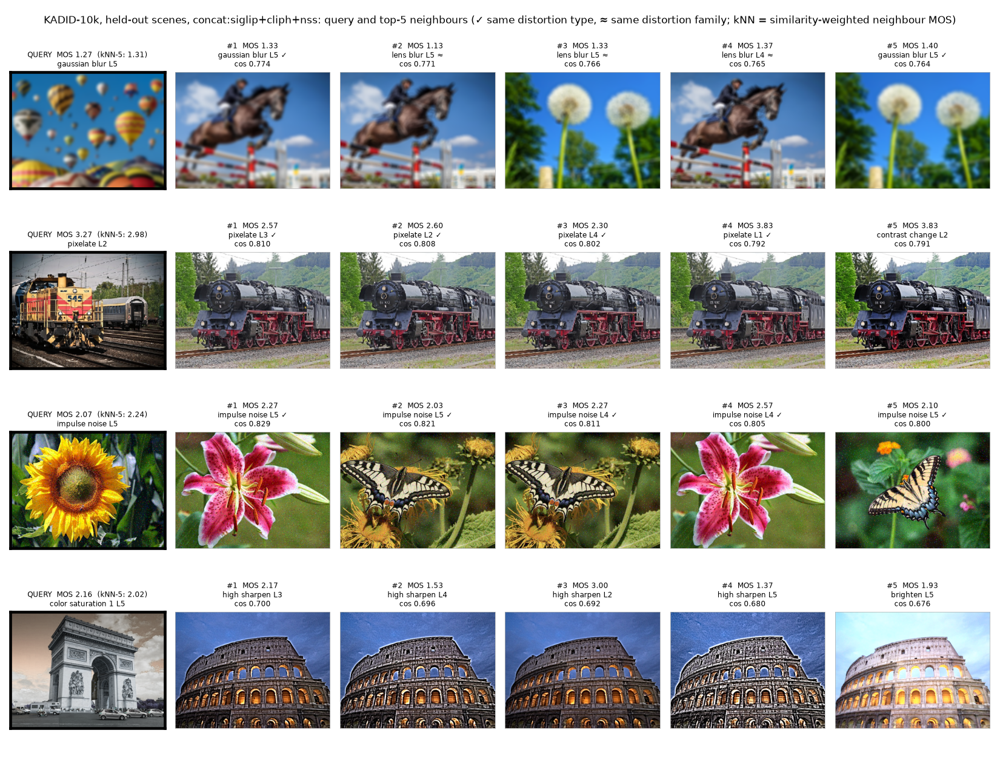

# retrieval-biqa

Does retrieving similar images with known quality scores improve blind image quality
prediction, and does the retrieved evidence actually explain the score?

This is a skills project. Retrieval for IQA has been done before (see Related work).
What this repo contributes is a careful protocol: leakage-free retrieval on the same splits as a
LoRA baseline, a cost-versus-accuracy comparison, a fair test of database updates against
refitting on two domain shifts, and checks of what the retrieved neighbours actually match.

## Summary
- **Retrieval does not beat LoRA.** Best retrieval method on KonIQ-10k: 0.913 SRCC. LoRA r8 on
  the same splits: 0.950. Retrieval needs no GPU and ~2.3k trainable parameters; LoRA needs
  1.72M parameters and ~32 GPU-minutes per run.
- **Plain kNN on frozen embeddings is weak in-domain** (0.771, about 0.14 below a linear probe)
  because cosine similarity on SigLIP / CLIP features is organised by content, not quality.
- **As a correction on top of a probe, retrieval adds a small, consistent gain**
  (+0.002 to +0.004 SRCC, 15/15 paired comparisons; a shuffled-evidence control falls below the probe).
- **"Update without retraining" does not beat refitting the head.** On KonIQ → KADID-10k a
  weighted ridge refit recovers ~72% of the gap to the in-domain ceiling with 250 target images;
  adding the same images to the retrieval database recovers ~13%.
- **The evidence exists; it is used weakly.** With scenes held out, KADID neighbours share the
  query's distortion type at 11-14× chance. But they rarely share its severity, and averaging
  their scores discards exactly that.

## Status
| Exp | What | Status |
|---|---|---|
| E0 | Linear probe on frozen features; LoRA reference from multimodal-biqa | done |
| E1 | Training-free kNN (k, embedding, temperature sweep) | done |
| E1b | Does retrieval add anything beyond a probe? PLS-kNN and probe + residual kNN | done |
| E2 | Retrieval + learned cross-attention head | dropped: in-domain headroom ~0.003 SRCC (Finding 3) |
| E3 | Database update vs refit: KonIQ → LIVE-itW and KonIQ → KADID-10k (scenes held out) | done; LoRA arm optional |
| E4 | What do neighbours match on KADID: scene, distortion type, family? Figures | done |
| E5 | VLM given retrieved images + scores (stretch) | not started |

## Results
KonIQ-10k, the 5 reference-level splits used for the LoRA experiments, mean ± std on test.

| Method | Trainable params | SRCC | PLCC |
|---|---|---|---|
| kNN, frozen features (E1, concat SigLIP+CLIP-H+NSS, k 10-20) | 0 | 0.771 ± 0.007 | 0.791 ± 0.005 |
| Linear probe, SigLIP (E0) | 1,153 | 0.881 ± 0.006 | 0.901 ± 0.002 |
| Linear probe, SigLIP2 (E0) | 1,153 | 0.878 ± 0.008 | 0.902 ± 0.005 |
| Linear probe, CLIP-H (E0) | 1,025 | 0.894 ± 0.006 | 0.912 ± 0.003 |
| Linear probe, SigLIP + CLIP-H + NSS (E1b) | 2,315 | 0.910 ± 0.004 | |
| Probe + residual kNN, SigLIP + CLIP-H + NSS (E1b) | 2,315 | **0.913 ± 0.004** | |
| LoRA r8 (q,v), SigLIP (multimodal-biqa, reference) | 1.72M (0.23% of backbone) | **0.950 ± 0.002** | 0.960 |

**Finding 1. Plain retrieval on frozen embeddings is weak.** kNN is 0.11-0.14 SRCC below a
linear probe on the same features. The quality signal is present (the probe finds it), but
cosine similarity is dominated by content, so nearest neighbours share scenes, not quality.
Shuffling neighbour scores drops kNN to ~0 SRCC. Every E1 number reproduces exactly on rerun.

**Finding 2. A supervised metric fixes most of that, but not enough.** kNN in a PLS projection
(8-16 dims, fitted on train MOS) reaches 0.887 (CLIP-H) and 0.872 (SigLIP), close to the probe,
so E1 failed because of the similarity measure. It still never beats the probe, and on the
concatenated features it falls further behind (0.884 vs 0.910).

**Finding 3. As a correction, retrieval adds a small but consistent gain.** Probe plus a
similarity-weighted mean of the neighbours' out-of-fold residuals:

| Embedding | Probe | Probe + residual kNN | Gain | Splits improved | Shuffled residuals |
|---|---|---|---|---|---|
| CLIP-H | 0.8941 ± 0.0058 | 0.8972 ± 0.0053 | +0.0031 | 5/5 | 0.8910 |
| SigLIP | 0.8813 ± 0.0060 | 0.8834 ± 0.0058 | +0.0021 | 5/5 | 0.8781 |
| SigLIP + CLIP-H + NSS | 0.9095 ± 0.0039 | **0.9132 ± 0.0036** | +0.0037 | 5/5 | 0.9070 |

Real (15/15 paired comparisons; shuffled residuals fall below the probe) but small. The best k
is usually 50-100: a broad, scene-level bias correction rather than close matches. A learned
head (E2) could at best capture this ~0.003, so E2 was dropped.

**Finding 4. Retrieval does not beat LoRA in-domain.** LoRA r8 reaches 0.950 against 0.913, a
gap of 0.037 (over 10× the split std). The ridge probes here match the multimodal-biqa frozen
heads to within 0.001 SRCC on the same splits (SigLIP 0.8813 vs 0.8825; SigLIP+CLIP-H+NSS 0.9095
vs 0.9088), which cross-checks splits and features between the two codebases.

**Finding 5. KonIQ → LIVE-itW is too small a shift to separate the methods (E3).** Paired
delta-SRCC against the zero-shot KonIQ probe, mean over 5 source splits × 10 support draws:

| N target images | Concat: database update (mixed, k=100) | Concat: ridge refit | CLIP-H: database update | CLIP-H: ridge refit |
|---|---|---|---|---|
| 10 | +0.0004 | +0.0008 | +0.0040 | +0.0070 |
| 25 | +0.0015 | +0.0020 | +0.0047 | +0.0109 |
| 50 | +0.0033 | +0.0026 | +0.0066 | +0.0119 |
| 100 | +0.0051 | +0.0038 | +0.0080 | +0.0147 |

Zero-shot is 0.823 (concat) against an in-domain LIVE-itW ceiling of 0.836: only ~0.013 SRCC to
recover. A target-only index hurts (k = 5: −0.03 to −0.05).

**Finding 6. On a large shift, refitting beats the database update by 4-5× (E3, KonIQ →
KADID-10k).** Support images come only from KADID training scenes; test images from held-out
scenes. Zero-shot ≈ 0.730 (concat) and 0.666 (CLIP-H), against in-domain ceilings of 0.888 and
0.848. Paired delta-SRCC, concat features, mean of 50 runs:

| N | Database update (mixed, k=100) | Ridge refit | Refit, target at 10% weight | Refit + residual kNN |
|---|---|---|---|---|
| 10 | +0.001 | +0.009 | **+0.022** | +0.009 |
| 50 | +0.005 | +0.032 | **+0.072** | +0.034 |
| 100 | +0.014 | +0.059 | **+0.101** | +0.063 |
| 250 | +0.021 | +0.086 | **+0.113** | +0.089 |

The weighted refit (weight fixed before seeing results) recovers ~72% of the gap at N = 250 with
~4% of KADID's training data; the database update ~13%. Retrieval on top of the refit adds
+0.002 to +0.004 (up to +0.007 on CLIP-H). On CLIP-H, a target-only index (k = 10) beats the
plain refit at N ≤ 50 but never the weighted refit.

**Finding 7. With scenes available, neighbours are the same scene (E4).** Among all KADID images
(self excluded), 97-100% of the top-20 neighbours are the query's own scene under another
distortion, for SigLIP, CLIP-H and the concatenation (chance 1.2%). NSS, which measures image
statistics rather than content, is the exception (71% at k = 20).

**Finding 8. With scenes held out, neighbours carry real distortion evidence (E4).**

| Features | Same type @1 / @10 (chance 0.04) | Same type and level @1 (chance 0.008) | kNN-MOS SRCC on KADID (k=5) |
|---|---|---|---|
| SigLIP + CLIP-H + NSS | 0.550 / 0.446 | 0.313 | 0.757 |
| CLIP-H | 0.589 / 0.402 | 0.330 | 0.818 |
| SigLIP | 0.511 / 0.345 | 0.257 | 0.775 |
| NSS | 0.389 / 0.343 | 0.208 | 0.508 |

Texture artifacts are easy to match (denoise, high sharpen, colour quantization, colour block,
impulse noise, JPEG: 0.72-0.83 at k = 10). Global photometric changes are hard (non-eccentricity
patch, mean shift, motion blur, contrast change, darken: 0.10-0.23). At the level of KADID's 7
distortion families, the concatenation matches 0.68 at k = 1 and 0.63 at k = 10 (chance 0.16).
Much of the exact-type error is confusion between related types: white noise is 0.39 by type
but 0.95 by family, Gaussian blur 0.30 and 0.66. Brightness changes stay hard even by family
(mean shift, darken, brighten 0.36-0.42; contrast change 0.34). The numbers reproduce exactly
on rerun.

The KonIQ probe ranks blur well within type (motion and Gaussian blur 0.92), since blur is common
in KonIQ, and fails on synthetic artifacts KonIQ never shows (mean shift 0.37, colour block 0.38,
non-eccentricity patch 0.38, contrast change 0.40). Per type, retrieval precision is **not**
related to the probe's failure (Spearman 0.08, p = 0.71), so "retrieval fails where the probe
fails" is not the explanation.

**Interpretation.** E3's database update did not lose for lack of evidence. Neighbours usually
share the right type of distortion but not its severity: in the figure below, a level-2 pixelated
query retrieves the same pixelation at levels 1-4 with MOS from 2.30 to 3.83, at almost the same
similarity. Averaging their scores discards the severity information that decides the quality.
A refit uses the same target images to change the head's direction for every image at once.



## Protocol
- **Scores:** MOS normalised to [0, 1] per dataset with its fixed scale (KonIQ 1-5,
  LIVE-itW 0-100, KADID 1-5), so datasets can share one index.
- **Splits:** the 5 reference-level splits used for the LoRA experiments (`splits/*_reference.json`),
  reported as mean ± std. No reference scene appears in both train and test (checked at load time).
- **No test leakage:** the index holds the train split only. Hyperparameters (k, embedding,
  temperature, ridge alpha) are picked on validation and reported once on test.
- **Out-of-fold residuals:** residuals stored in the index come from a model that never saw that
  image (5-fold cross-fitting inside train; inside the support set for the refit + kNN condition).
- **E3 support sets:** 10 seeded draws per N, identical for every method and source split, saved
  to `results/e3*/supports/`. Retrieval settings fixed in advance (no target validation set);
  every setting is reported. Main metric: paired delta-SRCC against zero-shot on the same images.
- **E3 on KADID:** support from the training scenes of the KADID reference split, test on its
  held-out scenes. NSS features of every dataset are standardised with KonIQ statistics.
- **Refits:** exact ridge from sufficient statistics (`models/fast_ridge.py`), identical to
  sklearn `Ridge` to ~1e-14.

## Setup
```bash
pip install -r requirements.txt          # FAISS optional; numpy fallback is fine at this scale
python -m pytest -q tests/               # synthetic-data checks of plumbing and leakage guards
```

This repo lives inside the `multimodal-biqa` project folder (`biqa-revision/`) and reads
from it directly, so results use **the same 5 splits as the LoRA experiments**:
```
biqa-revision/
├── cache/<dataset>_<backbone>.npz     names, feats (siglip, siglip2, cliph, nss, onealign)
├── manifests/<dataset>.csv            image, ref, mos
├── splits/<dataset>_reference.json    list of 5 splits
├── datasets/<dataset>/                images (only needed for figures)
└── retrieval-biqa/                    this repo
```

```bash
python scripts/check_setup.py --config configs/e1_koniq.yaml   # checks alignment, trains nothing
bash scripts/run_e0.sh          # linear probes
bash scripts/run_e1.sh          # training-free kNN
bash scripts/run_e1b.sh         # PLS-kNN, probe + residual kNN
bash scripts/run_e3.sh          # KonIQ -> LIVE-itW
bash scripts/run_e3_kadid.sh    # KonIQ -> KADID-10k (~1.6 h on CPU)
bash scripts/run_e4.sh          # what neighbours match; writes figures to notebooks/figures/
```
All runs are CPU-only on cached features. Each writes to `results/<exp>/` and adds its row to
`results/cost.csv`.

## Layout
```
configs/    yaml per experiment
data/       manifest and split loaders (multimodal-biqa format), split checks
features/   load cached embeddings, aligned to manifest order
index/      exact inner-product index with exclusion guards and database update
models/     knn_regressor.py, fast_ridge.py
eval/       SRCC, PLCC (4-parameter logistic), protocol helpers, cost table
scripts/    run_e0 ... run_e4, make_figures.py, check_setup.py
notebooks/  figures/
tests/      synthetic-data tests (28)
```

## Related work
- X. Wang et al., *Regression-free Blind Image Quality Assessment with Content-Distortion
  Consistency*, arXiv:2307.09279. Hierarchical kNN retrieval for BIQA.
- K. Fu et al., *Enhancing Image Quality Assessment Ability of LMMs via Retrieval-Augmented
  Generation* (IQARAG), arXiv:2601.08311. Retrieved images and MOS as LMM context; KonIQ,
  LIVEC, KADID, SPAQ.
- K. Fan et al., *ME-IQA: Memory-Enhanced Image Quality Assessment via Re-Ranking*,
  arXiv:2603.20785.
- *QualiRAG: Retrieval-Augmented Generation for Visual Quality Understanding*, arXiv:2601.18195.
